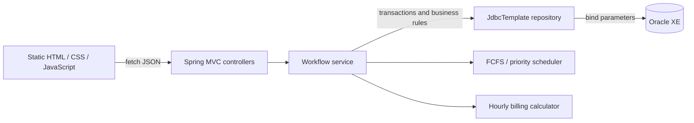
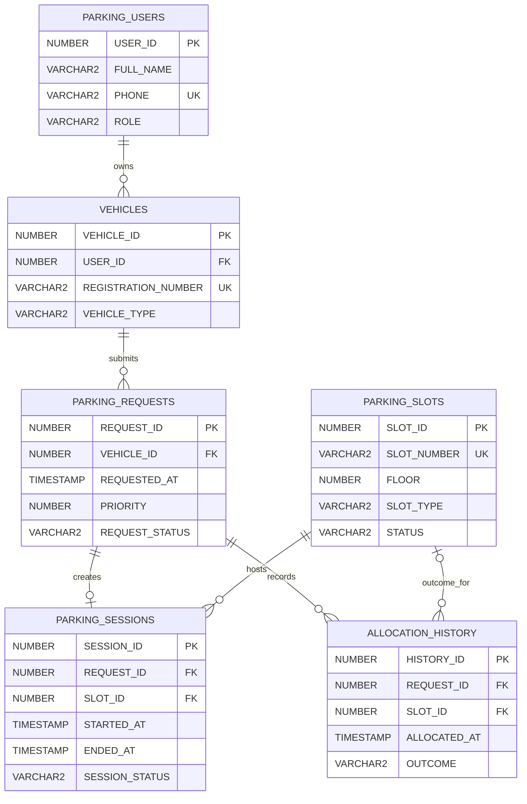

# Smart Parking Allocation System

A Java 25, Spring Boot, Spring JDBC, Oracle XE, and vanilla JavaScript prototype demonstrating slot inventory, vehicle requests, scheduling, transactional allocation, and session billing. The existing inventory APIs and dashboard are retained and extended.

## Current milestone

Implemented: slot CRUD and filters; user and vehicle registration; parking request submission; FCFS and priority request ordering; exact-type slot compatibility; allocation and release; active sessions and allocation history; configurable hourly billing; responsive dashboard views; Oracle constraints and indexes; unit tests and a controlled concurrent-claim test.

Not implemented: authentication/authorization (the role column is only data), payments, cancellations, live Oracle integration tests, arbitrary allocation policies, and a production deployment/security setup. Treat this as a local academic prototype, not a public service.

## Requirements and configuration

- JDK 25
- Maven 3.9+
- Oracle Database 11g XE or a compatible Oracle database

The connection URL and username remain configured for the existing local XE setup. The existing password was moved out of the source application configuration into the ignored root-level `application-local.properties`, preserving the local value. Alternatively, define `PARKING_DB_PASSWORD` in the process environment; it takes precedence. Do not commit that local file or place credentials in documentation.

For a fresh checkout, create `application-local.properties` locally:

```properties
parking.db.password=<your local Oracle password>
```

The database remains `parking_app` at the existing XE URL; no alternative credentials are assumed. The hourly rate is set by `parking.billing.hourly-rate` in `src/main/resources/application.properties` (default `2.00` per hour).

## Oracle setup and safety

There are separate scripts for separate database states:

- **Fresh, empty schema only:** `src/main/resources/db/schema_fresh_oracle.sql`
- **Existing schema with `PARKING_SLOTS` and `PARKING_SLOT_SEQ`:** `src/main/resources/db/phase1_oracle.sql`
- **Optional repeatable demo user and vehicle seed:** `src/main/resources/db/sample_data_oracle.sql`

The fresh-schema DDL is a one-time setup. The existing-schema script is also one-time DDL; it adds `FLOOR` and `SLOT_TYPE` to existing slots and creates the allocation tables/sequences/indexes. It is **not safe to rerun**. Back up the schema and inspect its current objects and sequence state before choosing a script. Do not run the fresh-schema script on an existing database. The sample-data script uses `MERGE`, only inserts missing demo keys, and does not delete or overwrite rows.

No SQL was executed while implementing or validating this code. The actual Oracle schema has not been queried in this session, so compare the selected script with the real schema before applying it. Do not reset or recreate `PARKING_SLOT_SEQ` or existing slot IDs.

## Build, test, and run

```powershell
mvn test
mvn package
mvn spring-boot:run
```

Open `http://localhost:8080/`. The application serves its static dashboard from `src/main/resources/static/`. Database-backed endpoints that use `FLOOR`, `SLOT_TYPE`, or workflow tables require the relevant schema script to have been reviewed and applied first. `/api/health` is independent of Oracle; `/api/database/test` checks the configured Oracle connection.

## API

All request and response bodies are JSON. Slot status is `AVAILABLE`, `OCCUPIED`, or `RESERVED`; slot and vehicle types are `BIKE`, `CAR`, and `EV`. A vehicle is allocated only to a slot of the same type.

### Inventory

| Method and path | Behavior |
|---|---|
| `GET /api/parking/stats` | Total, available, occupied, reserved counts |
| `GET /api/parking/slots?status=AVAILABLE&floor=0` | Filtered slot list |
| `GET /api/parking/slots/{id}` | Slot detail |
| `POST /api/parking/slots` | Create a slot |
| `PUT /api/parking/slots/{id}` | Update slot details |
| `PATCH /api/parking/slots/{id}/status` | Change slot status |
| `DELETE /api/parking/slots/{id}` | Delete only when no session history references it |

Example:

```json
POST /api/parking/slots
{
  "slotNumber": "C-01",
  "floor": 0,
  "slotType": "CAR",
  "status": "AVAILABLE"
}
```

### Users, vehicles, requests, and sessions

| Method and path | Behavior |
|---|---|
| `GET /api/parking/users`, `POST /api/parking/users` | List/register users |
| `GET /api/parking/vehicles`, `POST /api/parking/vehicles` | List/register vehicles |
| `GET /api/parking/requests`, `POST /api/parking/requests` | List/create requests |
| `GET /api/parking/requests/{id}` | Request detail |
| `POST /api/parking/requests/{id}/allocate` | Allocate this request only if it is next eligible under the chosen algorithm |
| `POST /api/parking/requests/allocate-next` | Allocate the next eligible request |
| `GET /api/parking/requests/scheduling/simulate` | Compare pending FCFS and priority orders |
| `GET /api/parking/sessions/active` | List active sessions and estimated fees |
| `GET /api/parking/sessions/{id}` | Session details and estimated/final fee |
| `POST /api/parking/sessions/{id}/release` | Close a session, free its slot, and return the fee |
| `GET /api/parking/history` | Allocation outcomes and associated session times |

Example workflow bodies:

```json
POST /api/parking/users
{ "fullName": "Demo Driver", "phone": "555-0100" }

POST /api/parking/vehicles
{ "userId": 1, "registrationNumber": "ABC-123", "vehicleType": "CAR" }

POST /api/parking/requests
{ "vehicleId": 1, "priority": 20 }

POST /api/parking/requests/allocate-next
{ "algorithm": "PRIORITY" }
```

An allocation response includes `requestId`, `sessionId`, `slot`, and `algorithm`. A release response includes `durationSeconds`, `chargedHours`, `hourlyRate`, and `fee`. Any positive partial hour rounds up; a zero-duration session is free. Higher numeric priority wins (0–100), then earlier request time, then lower request ID. FCFS orders by request time and then request ID.

Invalid values return HTTP 400, missing records HTTP 404, and uniqueness, scheduling, or no-compatible-slot conflicts HTTP 409. A request with no compatible available slot remains pending and its failed attempt is recorded in history.

## Concurrency and transaction design

Request status is conditionally claimed (`PENDING` to `ALLOCATED`) within a transaction. Candidate slots are selected deterministically and claimed with a conditional database update that succeeds only while the row is still `AVAILABLE`. Session creation, slot status, request status, and history are in the same transaction; an exception rolls the transaction back. The unique function-based Oracle index allows at most one `ACTIVE` session per slot. Slot edits lock the slot row before checking the active-session invariant.

The concurrency unit test starts multiple Java executor tasks against a single simulated conditional claim and verifies there is one winner. It validates the claim contract, not Oracle locking itself. The database-level guard is the authoritative protection across application instances; an in-process lock alone would not be sufficient. No Oracle-backed race test or rollback integration test was run because no database schema changes or SQL were executed.

## Architecture



## Data model



## Concepts demonstrated

- **DBMS:** normalized user/vehicle/request/session/history tables; primary, foreign, unique, and check constraints; Oracle sequences; bind parameters; aggregate statistics; indexed request/session queries; explicit transactions; and conditional updates to maintain allocation state.
- **Operating systems:** FCFS and priority scheduling, deterministic tie-breaking, and a controlled multi-threaded race simulation. In production flow, database row/unique constraints provide cross-process synchronization; Java executor threads demonstrate contention without using sleeps. Deadlock prevention relies on short transactions and a consistent slot/request update order; there is no deadlock-prone teaching simulation in this milestone.
